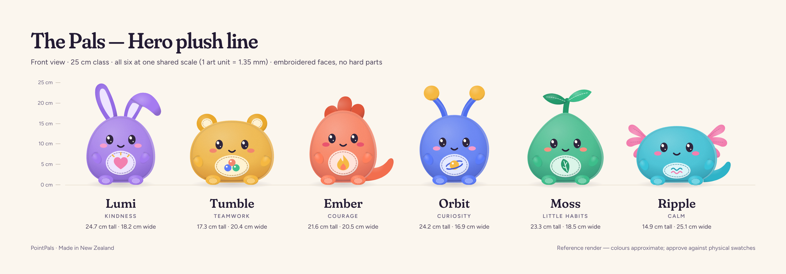
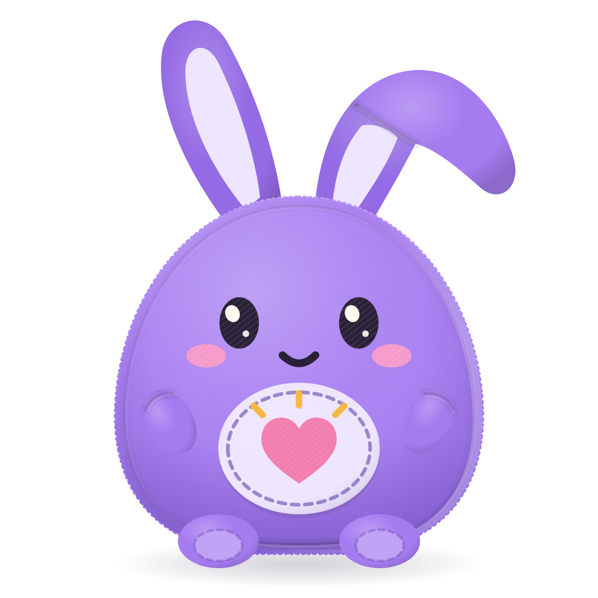
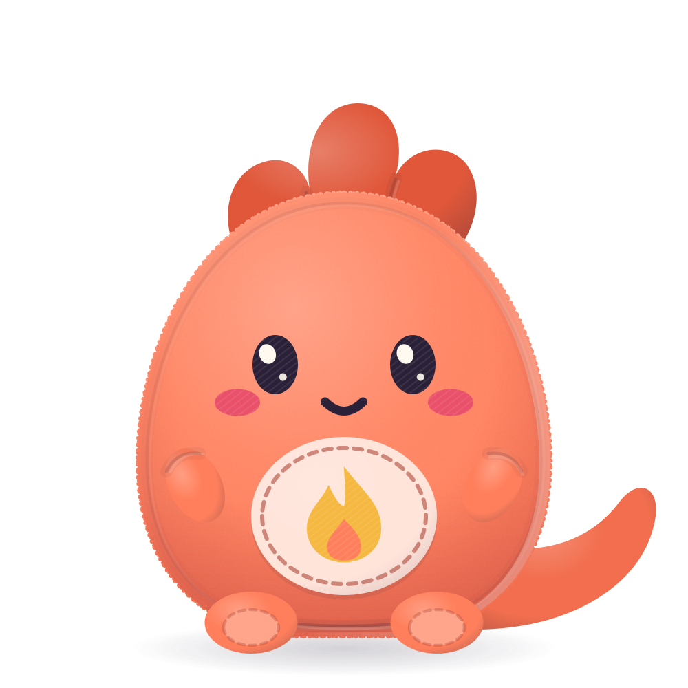
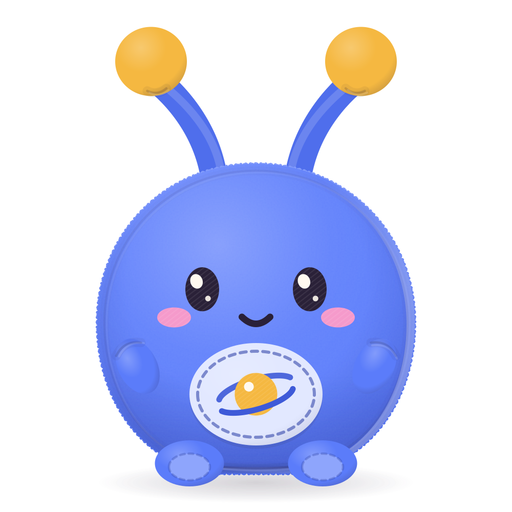
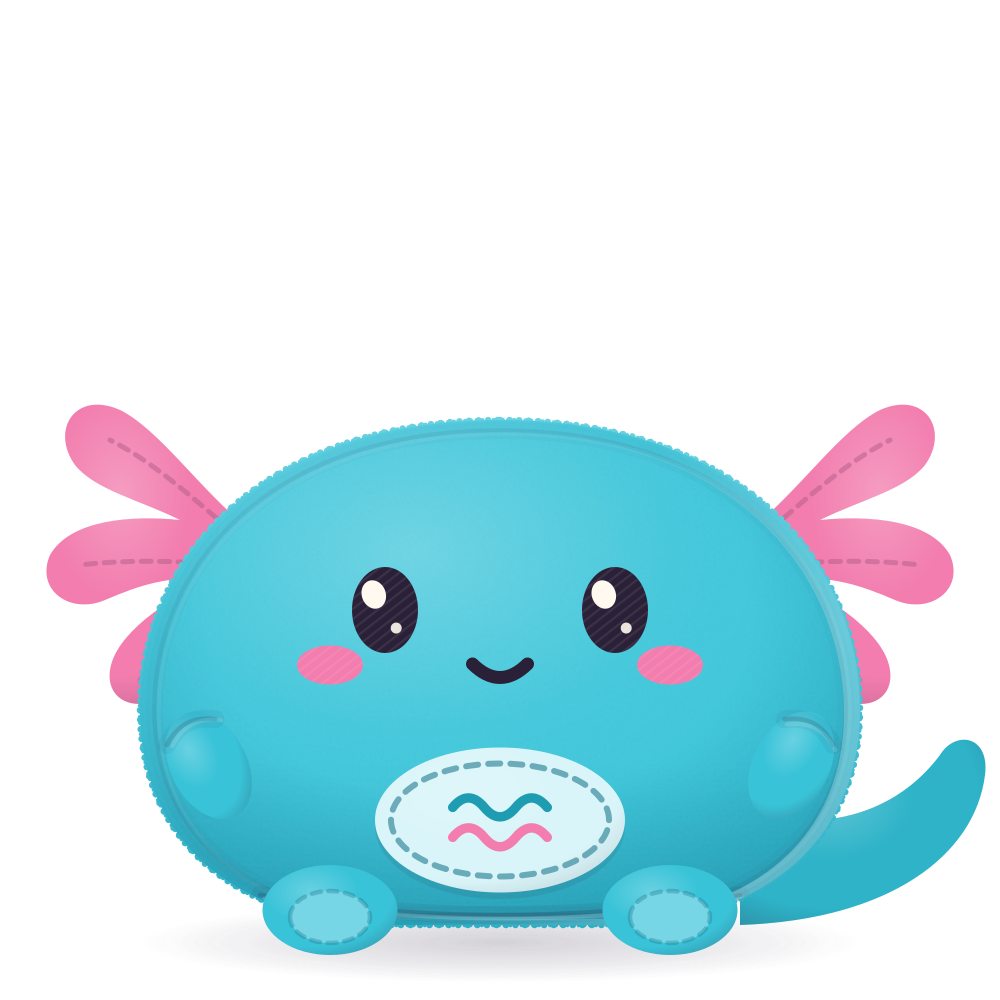

# The Pals — plush manufacturing brief

**Brand:** PointPals (Made in New Zealand) · **Line:** The Pals, plush collection v1
**Status:** Design intent, ready for factory quotation and first prototypes
**Source of truth for art:** `src/components/pals/Pal.tsx` (the in-app character renderer). Every
reference image in this brief is generated from that file, so the plush and the app stay identical.

---

## 1. Collection overview and intent

PointPals is a free family app. Parents notice the good stuff (a chore done, a kind moment) and each
point drops a marble into a shared family jar. When the jar is full, the family celebrates a reward
they chose together. The Pals are the six characters who live in that jar. Each one stands for a
family value:

| Pal    | Value         | Signature appendage                    | Body fabric |
| ------ | ------------- | -------------------------------------- | ----------- |
| Lumi   | Kindness      | Two long ears, the right one flopped   | Plum        |
| Tumble | Teamwork      | Round bear ears with felt-lined discs  | Saffron     |
| Ember  | Courage       | Three-lobed soft crest + stubby tail   | Coral       |
| Orbit  | Curiosity     | Two stuffed antennae with fabric balls | Cobalt      |
| Moss   | Little habits | Stuffed two-leaf sprout                | Jade        |
| Ripple | Calm          | Three-lobed gill fan each side + tail  | Aqua        |

**Design intent: a premium toy, not a promo plush.** We want the Jellycat end of the shelf: soft
matte minky, quiet colour, beautiful embroidery and a sit-down posture that looks good on a bed or
a bookshelf. The Pals should appeal to children aged 5 to 11 without looking babyish. Parents
should want them in the house.

**One family, one system.** All six Pals share:

- **One base body pattern** (front, back, base gusset), graded into six proportions (pear, dumpling,
  egg, ball, gumdrop and low-wide).
- **One embroidered face file**, with eye spacing graded in three steps.
- **The same arm nubs, foot nubs and belly appliqué construction.**
- **One signature appendage per Pal.** That appendage carries the silhouette, so each Pal is
  recognisable from across a room. Don't add accessories.

**Plush face = the app's `idle` expression.** The app also draws happy, wow and sleepy faces. Those
are screen-only and are **not** produced.

---

## 2. Sizes

All dimensions come from the reference art at one **shared scale: 1 art unit = 1.35 mm**. Because
the scale is shared, the Pals stand together as a family (Lumi is tallest, Ripple is low and wide).
It also lets one face embroidery program serve the whole line.

### 2.1 Hero: 25 cm class, sit-down plush (0+)

| Pal    | Overall H × W (cm)  | Body H × W (cm) | Est. depth (cm) | Base gusset oval (cm) | Fill, approx. (g) |
| ------ | ------------------- | --------------- | --------------- | --------------------- | ----------------- |
| Lumi   | 24.7 × 18.2         | 16.1 × 16.6     | 12.5            | 11.5 × 9.0            | 130–150           |
| Tumble | 17.3 × 20.4         | 15.0 × 20.3     | 14.0            | 14.0 × 10.0           | 150–170           |
| Ember  | 21.6 × 20.5 (tail)  | 17.4 × 16.2     | 12.5            | 11.0 × 9.0            | 130–150           |
| Orbit  | 24.2 × 16.9         | 16.3 × 16.7     | 14.0            | 11.5 × 10.0           | 140–160           |
| Moss   | 23.3 × 18.5         | 16.9 × 18.4     | 13.5            | 13.0 × 9.5            | 140–160           |
| Ripple | 14.9 × 25.1 (gills) | 13.6 × 19.4     | 14.5            | 14.0 × 10.5           | 130–150           |

- **Tolerance:** ±5% on any dimension, and ±1 mm on face placement (see §4.2).
- **Depth and fill weights** are estimates. Confirm them at first prototype, then lock them in the
  golden sample.
- **Posture:** sits upright unaided on a flat base gusset, with feet forward. See §4.5 for the
  optional sit-weight.

### 2.2 Marble Pal: 12 cm bag-clip (3+)

Same characters at **0.48× Hero** (Lumi is about 12 cm tall). This is a keepsake for school bags,
not a cot toy, so it is **age-graded 3+** because of the clip hardware.

| Change from Hero | Marble Pal construction                                                                                                                                          |
| ---------------- | ---------------------------------------------------------------------------------------------------------------------------------------------------------------- |
| Belly appliqué   | Dropped. The motif is embroidered directly on the front panel at 60% size.                                                                                       |
| Arms             | Dropped (front-panel embroidery reads cleaner at this size). Foot nubs stay.                                                                                     |
| Face             | Eyes 9 × 11.5 mm split-satin with a single teardrop highlight (no dot). Cheeks and mouth as Hero at 0.5×.                                                        |
| Thin parts       | Nothing under 7 mm finished width. Orbit's tubes are 8 mm (thickened from 0.48×). Ripple's gill fan is one 3-lobed piece with no vein stitching.                 |
| Attachment       | 10 mm woven polyester loop sewn **into the top seam beside the appendage** (never through it), bar-tacked. Nickel-free zinc-alloy lobster clasp on a split ring. |
| Sit-weight       | None.                                                                                                                                                            |
| Labelling        | "Not suitable for children under 36 months. Small parts." plus the standard law label.                                                                           |

---

## 3. Per-Pal sheets

Read each sheet with the shared construction in §4. Hex values are the screen targets taken from
the app. **The Pantone TCX references are nearest-match approximations from screen colour only.**
Confirm every colour against physical swatches and lab dips. The hex is the design intent, and the
TCX name is a starting point for the dye house.

Thread colours are listed per Pal. Every Pal uses **6 or fewer embroidery colours**, counting the
shared Ink and Warm White.

### 3.1 Lumi — Kindness

Reference: [`plush/lumi.svg`](plush/lumi.svg)

- **Silhouette:** soft pear body with two long ears. The left ear stands up and leans out slightly.
  The right ear is the same pattern, cut 15 mm longer and only lightly stuffed below the knee, so
  the top half flops outward. The flop is the character: it must be **sewn in**, so it flops the
  same way every time. Add a tack-stitch through the fold at the knee.
- **Body fabric:** short-pile minky, **#A57BF0**. Nearest TCX **17-3628 Amethyst Orchid**. The
  target is brighter and bluer, so lab-dip to the hex.
- **Appendages:** two ears, each made from an outer piece (body minky) and an inner piece (velboa,
  **#EEE5FF**, nearest TCX 13-3820 Lavender Fog), lightly stuffed. Ear length about 9.9 cm. Width at
  the base 2.7 cm, and never under 2.0 cm. Insert into the top seam, backstitch, then bar-tack.
- **Belly appliqué:** 73 × 59 mm oval in non-fraying polyester felt, **#EEE5FF**. Embroidered
  motif: a heart (34 × 30 mm, split-satin, **#F27DAE**) with three short glow rays (satin columns,
  **#F5B841**).
- **Soles:** velboa **#C1A3F6**.
- **Threads (6):** Ink #2A2138 · Warm White #FFF9F0 · Cheek Rose #F59ACB · Heart Rose #F27DAE ·
  Ray Gold #F5B841 · Topstitch Plum #6547A8.
- **Pattern pieces, approx. 17:** 13 shared (§4.1) + ear outer ×2 + ear inner ×2.

### 3.2 Tumble — Teamwork

Reference: [`plush/tumble.svg`](plush/tumble.svg)

- **Silhouette:** the widest Pal, a low bear-dumpling. Its round ears sit high and wide (centres
  about 12 cm apart) so they clear the head line in silhouette.
- **Body fabric:** short-pile minky, **#F5B841**. Nearest TCX **13-0942 Amber Yellow**. Shadows on
  this colour must stay warm: reject any lab dip that greys toward mustard or olive.
- **Appendages:** two ears, each a 5.0 × 4.7 cm disc pair (front and back in body minky), lightly
  stuffed. Inner-ear disc of velboa, **#FFF2D1** (nearest TCX 12-0712 Vanilla), 2.7 cm, appliquéd
  with a decorative running stitch in Topstitch.
- **Belly appliqué:** 84 × 54 mm felt oval, **#FFF2D1**. Motif: three marbles in a huddle, each
  17 mm across, in split-satin (Coral, Cobalt and Jade), each with a Warm White satin highlight.
- **Soles:** velboa **#F9CE78**.
- **Threads (6):** Ink #2A2138 · Warm White #FFF9F0 · Coral #F2846B (cheeks + marble) ·
  Cobalt #5B7CFA · Jade #3DBE8B · Topstitch Amber #A7731A.
- **Pattern pieces, approx. 19:** 13 shared + ear front ×2 + ear back ×2 + inner-ear disc ×2.

### 3.3 Ember — Courage

Reference: [`plush/ember.svg`](plush/ember.svg)

- **Silhouette:** upright egg. One soft three-lobed crest (9.8 × 6.2 cm) runs over the crown, and a
  stubby tail curls out to the right-hand side.
- **Body fabric:** short-pile minky, **#FF7F5C**. Nearest TCX **16-1546 Living Coral**.
- **Appendages:**
  - **Crest:** a deeper coral minky, **#E0573A** (nearest TCX 17-1456 Tigerlily). Cut as **one**
    three-lobed front/back pair, lightly stuffed. Topstitch two shallow valleys between the lobes
    so they read separately. Insert into the top seam. Each lobe is at least 2.2 cm wide.
  - **Tail:** body minky, a 6.0 × 5.4 cm two-piece shape, firmly stuffed. Insert into the right
    side seam just above the base gusset.
- **Belly appliqué:** 73 × 62 mm felt oval, **#FFE4DA**. Motif: a two-tone flame (29 × 38 mm), with
  an outer flame in split-satin **#F5B841** and an inner core in satin **#FF7F5C**.
- **Soles:** velboa **#FFA58C**.
- **Threads (6):** Ink · Warm White · Cheek Raspberry #E9506A · Flame Gold #F5B841 ·
  Flame Coral #FF7F5C · Topstitch Brick #AD4839.
- **Pattern pieces, approx. 17:** 13 shared + crest ×2 + tail ×2.

### 3.4 Orbit — Curiosity

Reference: [`plush/orbit.svg`](plush/orbit.svg)

- **Silhouette:** a round ball with two antennae that splay outward. The antennae are what make
  Orbit read at 40 px, and on the shelf.
- **Body fabric:** short-pile minky, **#5B7CFA**. Nearest TCX **18-3949 Dazzling Blue**. The target
  is lighter and brighter, so lab-dip to the hex.
- **Appendages:**
  - **Antenna tubes:** body minky, cut as a rectangle, folded and sewn into a tube. Finished width
    **14 mm** (never under 12 mm) and about 6 cm long. Firmly stuffed so they stand. Insert into
    the top seam with a bar-tack.
  - **Bobbles:** **stuffed fabric balls, never beads or pom-poms.** Each is a 3.8 cm gathered circle
    of saffron minky (**#F5B841**, the same fabric as Tumble's body), firmly stuffed. Close the
    gather around the tube end, then backstitch twice around the neck.
- **Belly appliqué:** 70 × 54 mm felt oval, **#E2E8FF**. Motif: a ringed planet. The planet is
  22 mm across in split-satin **#F5B841** with a Warm White highlight. The ring is a 2.6 mm satin
  column in **#3E5AD8** that passes behind the planet at the top and in front at the bottom.
- **Soles:** velboa **#8EA5FC**.
- **Threads (6):** Ink · Warm White · Cheek Rose #F59ACB · Planet Gold #F5B841 ·
  Ring Cobalt #3E5AD8 · Topstitch Navy #384AAB.
- **Pattern pieces, approx. 17:** 13 shared + tube ×2 + bobble ×2.

### 3.5 Moss — Little habits

Reference: [`plush/moss.svg`](plush/moss.svg)

- **Silhouette:** a gumdrop, narrow at the top and wide at the base, with a two-leaf sprout. The
  left leaf is darker than the right.
- **Body fabric:** short-pile minky, **#3DBE8B**. Nearest TCX **16-5938 Mint**. The target is
  lighter and softer.
- **Appendages:**
  - **Stem:** a folded tube in deep jade minky, **#23986A** (nearest TCX 17-5641 Emerald). Finished
    width 13.5 mm (never under 12 mm), firmly stuffed.
  - **Leaves:** two front/back pairs, lightly stuffed. The left leaf is deep jade **#23986A**; the
    right leaf is body jade **#3DBE8B**. Each leaf has a centre vein topstitched in **#DBF5E9**
    through both layers, which also stops the fill from shifting. Sprout spread is 11.9 cm.
- **Belly appliqué:** 76 × 54 mm felt oval, **#DBF5E9**. Motif: a leaf (28 × 36 mm, split-satin
  **#23986A**) with a centre vein and two side veins (satin, **#DBF5E9**).
- **Soles:** velboa **#79D3AF**.
- **Threads (6):** Ink · Warm White · Cheek Peach #F7907F · Leaf Jade #23986A · Vein Mint #DBF5E9 ·
  Topstitch Forest #25775C.
- **Pattern pieces, approx. 18:** 13 shared + stem ×1 + leaf ×4.

### 3.6 Ripple — Calm

Reference: [`plush/ripple.svg`](plush/ripple.svg)

- **Silhouette:** a low, wide axolotl. One three-lobed gill fan sits on each side, high on the head,
  and a paddle tail sweeps out to the right.
- **Body fabric:** short-pile minky, **#39C3D8**. Nearest TCX **15-4825 Blue Curacao**.
- **Appendages:**
  - **Gill fans:** rose minky, **#F27DAE** (nearest TCX 15-2216 Sachet Pink). Each side is **one**
    three-lobed front/back pair (5.5 × 8.1 cm), not separate fronds. That is stronger, simpler to
    sew and keeps the silhouette. Every lobe is at least 13 mm wide. Lightly stuffed. Each lobe gets
    a topstitched vein in **#B6618B**. Insert into the side seams.
  - **Tail:** body minky, a 5.1 × 4.1 cm two-piece paddle, lightly stuffed.
- **Belly appliqué:** 68 × 39 mm felt oval, **#DAF5F9**. It sits low and clear of the mouth (at
  least 8 mm gap). Motif: two rolling waves, each a 2.6 mm satin column, one **#1E9CB2** and one
  **#F27DAE**.
- **Soles:** velboa **#76D6E5**.
- **Threads (5):** Ink · Warm White · Rose #F27DAE (cheeks + lower wave) · Wave Teal #1E9CB2 ·
  Gill Vein #B6618B. The topstitch uses Wave Teal.
- **Pattern pieces, approx. 19:** 13 shared + gill fan ×4 + tail ×2.

---

## 4. Shared construction

### 4.1 Base body pattern (all Pals)

| Piece            | Qty    | Fabric         | Notes                                                                                                                     |
| ---------------- | ------ | -------------- | ------------------------------------------------------------------------------------------------------------------------- |
| Body front       | 1      | Body minky     | Embroider the face and attach the belly appliqué **on the flat panel before assembly**, using notched registration marks. |
| Body back        | 2      | Body minky     | Centre-back seam. Leave a 6–7 cm stuffing opening, then ladder-stitch it closed with locked knots.                        |
| Base gusset      | 1      | Body minky     | Flat oval (sizes in §2.1) so the Pal sits upright.                                                                        |
| Arm nub          | 2×2    | Body minky     | 20 × 31 mm finished. Sewn into the side seam at about 50% body height, angled toward the belly.                           |
| Foot nub (upper) | 2      | Body minky     | 36 × 24 mm finished. Sewn into the front/base-gusset seam, pointing forward.                                              |
| Foot sole        | 2      | Sole velboa    | 22 × 14 mm oval face, with a decorative running stitch 2 mm inside its edge in Topstitch.                                 |
| Belly appliqué   | 1      | Polyester felt | See per-Pal sheet.                                                                                                        |
| **Shared total** | **13** |                | Plus the per-Pal appendages. Pellet pouch (optional, §4.5) is not counted.                                                |

- **Seams:** 6 mm allowance; at least 10 stitches per inch (4/cm) on all structural seams.
  Double-stitch every appendage insertion and every opening.
- **Appendages** are always inserted into a seam (top, side or base), never stitched onto the
  surface. Backstitch them at the seam, then bar-tack.
- **Seam lines** in the reference art (the faint crease just inside the silhouette, and the curve
  along the base) show where the front, back and gusset meet. **They are not visible topstitching.**

### 4.2 Embroidered face (one program, graded eye spacing)

All features are machine embroidery on the body front panel. **Nothing is hard or glued:** no
safety eyes, no buttons, no beads, no printed or flock faces.

| Feature       | Size at Hero (mm)                                                                                                       | Stitch                                                         | Thread          |
| ------------- | ----------------------------------------------------------------------------------------------------------------------- | -------------------------------------------------------------- | --------------- |
| Eye           | 18 × 23 oval                                                                                                            | Split-satin at 38°, max float 6 mm; edge-run + zigzag underlay | Ink             |
| Eye highlight | 6.5 × 8 teardrop, tilted 20°; centre 3 mm left, 4 mm up from eye centre (same side on both eyes, light from upper-left) | Satin, stitched **on top of** the eye                          | Warm White      |
| Eye glint     | Ø 3 dot; centre 3 mm right, 5 mm down from eye centre                                                                   | Satin dot. No French knots (snag/loop risk).                   | Warm White      |
| Cheek         | 18 × 10.5 oval; centre 15 mm below and 15 mm outward of each eye centre                                                 | Split-satin at 38°, max float 6 mm                             | Cheek (per Pal) |
| Mouth         | Smile 15 wide × 3.6 deep, top of curve 14.5 mm below the eye line, centred                                              | 3.5 mm satin column (more robust than backstitch)              | Ink             |

**Eye spacing (centre to centre):**

| Spacing | Pals           |
| ------- | -------------- |
| 54 mm   | Lumi, Ember    |
| 57 mm   | Orbit, Moss    |
| 62 mm   | Tumble, Ripple |

**Eye-line height above the base seam:**

| Pal    | Height |
| ------ | ------ |
| Lumi   | 104 mm |
| Tumble | 92 mm  |
| Ember  | 107 mm |
| Orbit  | 97 mm  |
| Moss   | 95 mm  |
| Ripple | 85 mm  |

**Placement tolerance is ±1 mm, and eye symmetry is the first QA check.** A 2 mm drift changes the
character.

**Thread:** 100% polyester 40 wt embroidery thread (e.g. Madeira Polyneon or equivalent), which must
be colourfast to saliva and washing. The factory assigns final thread codes against the hex values
in §3. Use a tear-away or wash-away stabiliser only. **No fusible backing on 0+ product.**

### 4.3 Belly appliqué

- **Material:** non-fraying polyester felt, 1.0–1.2 mm thick, laser-cut.
- **Attachment:**
  1. Embroidery tack-down run.
  2. A tight 2 mm satin border in the felt colour. This seals the raw edge, which is needed for 0+.
  3. A decorative running stitch (bean/triple-run, 3 mm stitch length) about 4 mm inside the edge,
     in the Pal's Topstitch thread.
- **Motif:** embroidered after the appliqué is secured. Satin areas are split at a maximum float of
  6 mm.

### 4.4 Fabrics

| Use                            | Spec                                                                                                                                 |
| ------------------------------ | ------------------------------------------------------------------------------------------------------------------------------------ |
| Body, appendage outers         | 100% polyester short-pile minky ("super-soft"), pile 1.5–3 mm, about 300–350 gsm, matte finish. **No sheen or glitter.**             |
| Inner ears, soles              | 100% polyester velboa, pile 1–2 mm.                                                                                                  |
| Appliqué                       | Non-fraying polyester felt, 1.0–1.2 mm.                                                                                              |
| Fabric sharing (to reduce MOQ) | Saffron minky is Tumble's body and Orbit's bobbles. Rose minky is Ripple's gills. Coral and jade deep minkys are single-Pal fabrics. |

- **Colourfastness:** to saliva and perspiration (DIN 53160-1/-2), and to rubbing (ISO 105-X12).
  Target grade 4 or better.
- **Chemicals:** REACH Annex XVII compliant, with no restricted azo dyes. OEKO-TEX Standard 100
  (Class I, baby articles) certification is preferred for all fabrics and threads.

### 4.5 Fill and sit-weight

- **Fill:** 100% new polyester fibre (siliconised hollow conjugated fibre, 7D or 15D). Fill weights
  are in §2.1 (±5 g per piece). Fill evenly with no lumps. Appendages are "lightly stuffed" (gives
  under a fingertip) or "firm" as specified.
- **Optional sit-weight:** a sealed inner pellet pouch of about 60–80 g at the base, made of
  polyethylene pellets in a double-stitched non-woven pouch, enclosed in a second fabric pouch that
  is sewn into the base gusset seam (double containment).
  - **The default Hero SKU is pellet-free**, using denser fibre in the base, so it stays
    machine-washable and suitable for the youngest children.
  - Use pellets only where a retailer asks for them, and then the care label changes to surface
    wash.

---

## 5. Safety and compliance

**Target age grading:**

| Product        | Age | Why                                                                 |
| -------------- | --- | ------------------------------------------------------------------- |
| Hero           | 0+  | Embroidered features only, no small parts, no detachable components |
| Marble Pal     | 3+  | Clip hardware                                                       |
| Marble keyring | 14+ | For a grown-up's keys; not a toy                                    |

Test every SKU at an accredited third-party lab. The **test lab must confirm the current revision
of each standard** at the time of testing.

| Market                  | Standards / requirements                                                                                                                                                                                                                                                                                                                                                                                                        |
| ----------------------- | ------------------------------------------------------------------------------------------------------------------------------------------------------------------------------------------------------------------------------------------------------------------------------------------------------------------------------------------------------------------------------------------------------------------------------- |
| New Zealand / Australia | **AS/NZS ISO 8124.1** (mechanical & physical, including small parts, torque/tension and seams), **AS/NZS ISO 8124.2** (flammability), **AS/NZS ISO 8124.3** (migration of certain elements). Mandatory rules for toys for children up to 36 months: NZ Product Safety Standards (Children's Toys) Regulations; AU Consumer Goods (Toys for Children up to and including 36 Months of Age) Safety Standard.                      |
| EU / UK                 | **EN 71-1, EN 71-2, EN 71-3**, under the EU Toy Safety Directive 2009/48/EC (or its successor Regulation), with CE marking. UK Toys (Safety) Regulations 2011 with UKCA marking. REACH for textiles.                                                                                                                                                                                                                            |
| USA                     | **ASTM F963** (current revision), including the stuffed-toy seam strength tests and the 16 CFR 1501 small parts test for under 3. **CPSIA**: third-party testing at a CPSC-accepted lab, lead limits for substrates and any surface coatings, phthalates (if any plasticised component), a Children's Product Certificate, and permanent tracking labels. State stuffed-toy law labels and registration numbers where required. |
| Canada (if sold)        | Canada Consumer Product Safety Act, Toys Regulations (SOR/2011-17). Check provincial stuffed-article rules.                                                                                                                                                                                                                                                                                                                     |

**Design rules that keep the Hero at 0+:**

- **Embroidery only:** no hard eyes, noses, buttons, beads, sequins, bells or squeakers.
- **No thin parts under 12 mm** finished width at Hero size (Orbit's tubes are 14 mm, Moss's stem
  13.5 mm, Ripple's gill lobes at least 13 mm).
- **No cords, ribbons or loops** on the Hero.
- **No plastic tag barbs.** The hang tag is attached with a cotton thread loop through the law-label
  seam, marked "Remove before giving to child".
- **Seam and attachment strength, internal target:** every seam and every appendage (ears, crest,
  tail, antennae, bobbles, sprout, gill fans, arms, feet, appliqué) withstands **at least 90 N for
  10 s**. That means no seam opening that exposes fill and no detachment. This is at or above the
  ASTM F963 and EN 71-1 / ISO 8124-1 requirements; the lab confirms against each standard's exact
  method. Bobble necks and the Lumi ear-knee tack get extra attention.
- **Needle control:** 100% metal (needle) detection on finished goods, plus a broken-needle log.
- **Flammability:** the fabric pile must pass EN 71-2 and ISO 8124-2. **No brushed or flammable
  surface finishes.**

**Labelling (sewn-in law label):**

- **Position:** in the left side seam just above the base, cut flush, and soft.
- **Contents:**
  - Brand and New Zealand address
  - Country of origin
  - Batch/date code (CPSIA tracking label)
  - Fibre content ("All new material consisting of polyester fibres")
  - Age grading
  - CE and UKCA marks
  - US state registration numbers where required
  - Care symbols
- **Marble Pal** also carries: "Warning: Not suitable for children under 36 months. Small parts.
  Choking hazard."

---

## 6. Care label

**Hero (pellet-free):**

> Machine wash 30 °C gentle, inside a laundry bag. Reshape and air-dry flat, away from direct heat.
> Do not tumble dry, iron, bleach or dry clean. Brush the pile gently when dry.

**Hero with pellet pouch and Marble Pal:**

> Surface wash only with a damp cloth and mild soap. Air-dry. Do not machine wash, tumble dry,
> iron, bleach or dry clean.

---

## 7. Packaging concept: the jar

The packaging retells the app: **a Pal arrives in its own marble jar.**

- **Gift box:**
  - **Form:** a rigid cylindrical paperboard "jar" (FSC board, about Ø 21 × 27 cm for Hero), with a
    cream wrap and a deep aubergine lid shaped like a jar lid.
  - **Wrap:** illustrated with jewel marbles rising up the wrap.
  - **Lid:** debossed with the PointPals wordmark.
  - **Window:** none (plastic-free). A die-cut belly band shows the Pal's name and value.
- **Inside:**
  - **Cradle:** the Pal sits in a moulded-pulp cradle.
  - **Card:** a value card ("Lumi: Kindness. A kind thing makes the whole jar glow.") with a QR code
    to set up the free app.
  - **Marble keyring:** a jewel-colour resin marble keyring in the Pal's colour, for the grown-up's
    keys. It is packed in its own sealed paper sleeve, marked "For grown-ups. Not a toy.", and
    separated from the plush so the plush stays 0+.
- **Marble Pal:** a smaller jar tube, about Ø 8 × 14 cm, with a hanging slot in the lid.
- **Materials:** soy or vegetable inks, paper tape, no plastic film, all kerbside-recyclable.
- **Transit testing:** ISTA 1A drop test (or retailer equivalent) for the shipper.

---

## 8. QA checklist

**Pre-production**

- [ ] Lab dips for every fabric approved against the hex values in §3. Judge under D65 **and** warm
      (3000K) light, because saffron and coral shift most.
- [ ] Embroidery strike-off approved: eye shape, satin angle (38°), highlight placement, cheek tone,
      mouth curve. Overlay the strike-off on the 1:1 print of the reference SVG.
- [ ] First prototype for each Pal photographed front-on and overlaid on `docs/plush/<id>.svg`,
      printed at Hero scale (1 art unit = 1.35 mm). Silhouette, appendage angles and face position
      must match within tolerance.
- [ ] Golden sample sealed and signed for each Pal, and kept by both parties.
- [ ] Full lab test report (§5) passed before bulk.

**In-line**

- [ ] Face panel embroidered before assembly. Eye symmetry ±1 mm. Highlight on the same side
      (upper-left) on both eyes.
- [ ] Appliqué satin border fully closed, with no raw felt edge.
- [ ] Stitch density ≥ 4/cm. Appendage insertions double-stitched and bar-tacked.
- [ ] Lumi's right ear flops **outward** (to the viewer's right), with the knee tack in place.
- [ ] Orbit's antennae stand. Bobble necks are double backstitched.
- [ ] Fill weight ±5 g. No lumps. The Pal sits upright unaided on a flat surface.
- [ ] Closing ladder-stitch is invisible, with knots buried.

**Final inspection (AQL)**

- [ ] AQL: critical 0 (needles, detachable parts, open seams), major 2.5, minor 4.0.
- [ ] 100% metal detection passed. Detector calibrated every shift.
- [ ] Pull test on sampled units, on every appendage, the arms and the feet.
- [ ] Labels correct, legible and in position. Care symbols match the SKU (pellet vs pellet-free).
- [ ] No odour, loose threads, glue marks or fill leaks.
- [ ] Packaging: jar closes squarely and the keyring sleeve is sealed and separate. Shipper drop
      test passed.

---

## Appendix: regenerating the references

The SVGs in `docs/plush/` are serialised from `<Pal id size={1000} detail="full" />`. Class hooks
and animation are stripped, and each file carries a `<title>`. After changing any art in
`src/components/pals/`, regenerate the SVGs and `lineup.png`, then re-issue this brief to the
factory with a revision note.

| Concept                   | Where it lives                                                                               |
| ------------------------- | -------------------------------------------------------------------------------------------- |
| Body, face, belly, limbs  | `Pal.tsx`                                                                                    |
| Thread and shadow colours | `palette.ts`                                                                                 |
| Names, values, motifs     | `src/lib/pals.ts`                                                                            |
| Hero scale                | 1 art unit = 1.35 mm. Ground line at y = 190; base seam at y = 185 in the 200 × 200 art box. |
